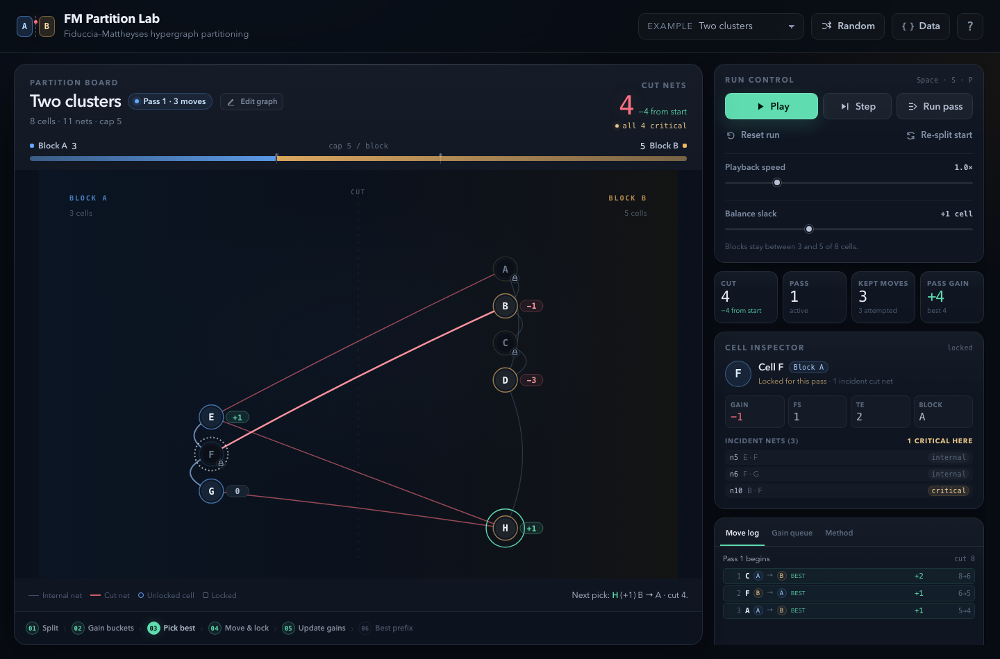

# FM Partition Lab

An interactive, dependency-free implementation of the **Fiduccia–Mattheyses (FM)** hypergraph partitioning algorithm. It runs entirely in the browser, works from `file://`, and exposes every part of the pass: gains, gain buckets, locking, incremental updates, best-prefix rollback, and convergence.



## Run it

Open `index.html` directly:

```bash
open index.html
```

Or serve the folder:

```bash
npm start
# http://localhost:4173
```

No install or build step is required.

## What you can do

- **Step through FM** one action at a time: open a pass, inspect the gain queue, move one cell, or close the current pass. The pulsing cell is the next pick.
- **Play or run a pass** with adjustable speed, then inspect the move ledger. Rolled-back moves stay in the log but are dimmed.
- **Inspect any cell** for its live gain, `FS`/`TE` breakdown, lock state, block size, and incident nets.
- **See the partition** as a hypergraph. Coral nets cross the cut; internal nets stay muted. Hyperedges use a small diamond hub.
- **Tune balance** with a per-block slack (`ceil(n/2) + slack`). Changing it restarts the run at the initial partition.
- **Edit the graph directly on the board** with `Edit graph`: drag cells to move them, double-click (or use the inspector) to rename, `Add cell` then click the canvas to place a cell, and `Connect` two or more cells into a new net. Select a net line to inspect or delete it, switch a cell's starting block in the inspector, or drag a cell across the cut.
- **Start over without JSON** with `Clear` inside the editor. It wipes every cell and net, keeps an undo snapshot, and turns on the add-cell tool so you can rebuild from an empty board.
- **Load or export hypergraph JSON** from the `Data` dialog. This is now an optional import/export path rather than the primary editor. Seeded random netlists are generated with the `Random` button.
- **Shuffle the starting split** with `Re-split start`, or reset back to the original start with `Reset run`.

Keyboard: `Space` play/pause, `S` step, `P` run pass, `R` reset.

Editor keyboard: `V` select/move, `N` add cell, `C` connect, `Enter` create the pending net, `Delete` remove the selected cell/net, `Esc` cancel or deselect, `⌘Z`/`Ctrl+Z` undo.

## Algorithm

The solver implements a two-way FM partitioner with unit-size cells and unit-cost nets:

1. **Partition.** Cells start in two blocks. Initial partitions are balanced.
2. **Compute gains.** For every cell `v`:

   ```text
   gain(v) = FS(v) − TE(v)
   ```

   - `FS(v)` — nets where `v` is the only cell on its side and the net also has cells on the other side. Moving `v` closes those nets.
   - `TE(v)` — nets wholly on `v`'s side. Moving `v` opens those nets.

   For a hyperedge, mixed sides with more than one cell on `v`'s side contribute zero.
3. **Pick and lock.** Select the highest-gain eligible unlocked cell. Ties prefer the move that leaves the blocks more balanced, then the lower cell index. Move the cell and lock it for the rest of the pass.
4. **Update incrementally.** Net-side counts are updated for every incident net, and only cells sharing one of those nets have their gains recomputed.
5. **Track the best prefix.** The cut may rise during a pass. The engine snapshots the partition at the lowest cut seen.
6. **Roll back and repeat.** At pass end, restore the best prefix and unlock all cells. If the cut improved, start another pass. Otherwise the solver is converged.

Balance eligibility requires the source block to stay above the lower bound and the destination block to stay below the upper bound. At `slack = 0`, a balanced start has no legal single-cell move; use `slack ≥ 1` to allow FM to work.

## Graph JSON

Direct editing is the primary workflow. The **Data** button remains available for pasting or copying JSON. The `initialPartition`, `layout`, and net labels are optional.

```json
{
  "name": "Tiny example",
  "description": "Three nets, four cells",
  "nodes": [
    { "id": "A", "label": "A" },
    { "id": "B" },
    { "id": "C" },
    { "id": "D" }
  ],
  "nets": [
    { "id": "n1", "cells": ["A", "B", "C"] },
    { "id": "n2", "cells": ["A", "D"] },
    { "id": "n3", "cells": ["C", "D"] }
  ],
  "initialPartition": [0, 1, 0, 1]
}
```

Requirements:

- At least two unique cell IDs to finish the graph editor. The editor itself permits a blank draft while you rebuild.
- Each net needs at least two valid cell IDs; duplicates within a net are removed.
- `initialPartition` uses `0` for Block A and `1` for Block B. If omitted or the wrong length, the engine uses an alternating start.
- `edges: [["A","B"], …]` is accepted as a shorthand for two-terminal `nets`.
- `layout` is optional editor metadata: `{ "A": { "y": 0.2, "dx": 0.04 } }`. `y` is the normalized vertical position and `dx` is the normalized horizontal offset from the cell's block column.

The board is tuned for roughly 18 cells or fewer; larger graphs still run, but labels and nodes get compact.

## Project layout

```text
index.html          App shell, dialogs, SVG board
css/styles.css      Visual design and responsive layout
js/fm.js            FM engine, gain calculations, pass/rollback state machine
js/presets.js       Example hypergraphs and seeded random netlist generator
js/app.js           GUI, animation, graph editor, logs, inspector, import/export
tests/fm.test.js    Node test suite for algorithm invariants and presets
```

## Tests

```bash
npm test
```

The suite checks, among other properties:

- Move gain equals the exact cut reduction on every move, including hyperedges.
- Independent cut recomputation matches the engine after every step.
- Block bounds, lock counts, and net bookkeeping stay valid.
- Best-prefix rollback restores the accepted cut and unlocks every cell.
- Accepted pass cuts are monotone and preset solutions are stable.
- Random connected netlists terminate and improve or preserve the initial cut.
- Reset, slack changes, gain-queue ordering, and greedy selection agree.

## Notes and limits

- Two-way partitioning only.
- Unit cell areas and unit net costs; weighted variants are not exposed in the UI.
- The implementation favors clarity and inspectability over large-instance performance. Gain refresh touches the moved cell's net neighborhood; selection scans eligible unlocked cells.
- The visual graph is an abstract board, not a force-directed drawing. Cells stay in their block columns; the editor can adjust vertical order and horizontal offset, and solver moves animate across the cut.
- Clearing the board creates an empty draft state. Finish editing requires at least two cells; the solver does not run while the editor is open.
