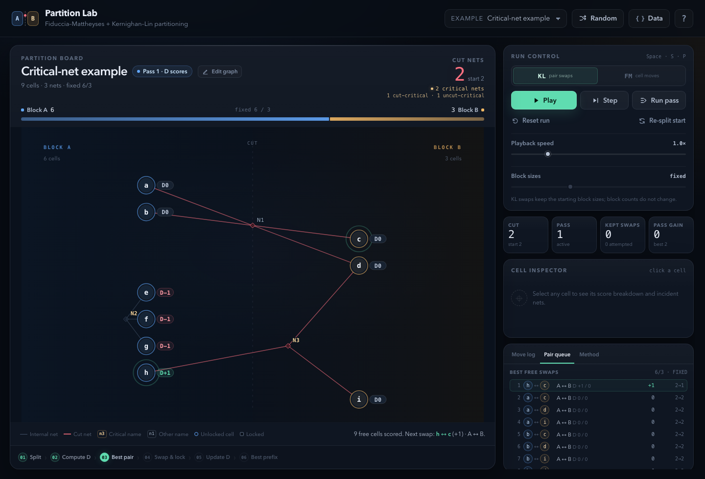

# Partition Lab

An interactive, dependency-free lab for **Fiduccia–Mattheyses (FM)** and **Kernighan–Lin (KL)** partitioning. It runs entirely in the browser, works from `file://`, and exposes every part of each pass: scores, locks, rollback, and convergence. The original FM app is the same codebase; the visible app and package now cover both algorithms.

**Live demo:** [superzeldalink.github.io/hypergraph-partition-lab](https://superzeldalink.github.io/hypergraph-partition-lab/)


## Run it

Open `index.html` directly:

```bash
open index.html
```

Or serve the folder:

```bash
npm start
# http://localhost:4173
```

No install or build step is required. The app is plain HTML, CSS, and JavaScript.

## What you can do

- **Switch between KL and FM** with the segmented control in Run control. The app opens in KL mode; FM moves one cell per step, while KL swaps one cell from each block.
- **Step through a pass**: open a pass, inspect the gain queue (FM) or pair queue (KL), advance one action, or close the current pass. The pulsing cell(s) show the next action.
- **Play or run a pass** with adjustable speed, then inspect the move/swap ledger. Rolled-back actions stay in the log but are dimmed.
- **See every net name.** Critical net names are amber; noncritical net names are steel blue. Coral lines cross the cut, muted lines stay inside a block, and the selected net in the editor is mint.
- **Inspect any cell** for its live score, `FS`/`TE` breakdown, lock state, block size, and incident nets. In KL mode the score is `D(v)` and the inspector shows the best free swap involving that cell.
- **Inspect any net in the editor** for `A`/`B` counts, a plain-language criticality callout, and its cells. Cut-critical, uncut-critical, and noncritical `2/2` nets are all explained; in run mode, a cell's incident-net badges show the same A/B state.
- **Tune balance** with FM's per-block slack (`ceil(n/2) + slack`). KL preserves the starting block sizes and disables the slack control.
- **Edit the graph directly on the board** with `Edit graph`: drag cells, double-click to rename, add cells, connect cells into a new net, change a cell's starting block, or delete a cell/net. `Clear` wipes the board, and undo restores it.
- **Load or export hypergraph JSON** from the `Data` dialog. Seeded random netlists are generated with the `Random` button.
- **Re-split start** with a balanced alternating start, or reset back to the original start with `Reset run`.

Keyboard: `Space` play/pause, `S` step, `P` run pass, `R` reset.

Editor keyboard: `V` select/move, `N` add cell, `C` connect, `Enter` create the pending net and stay in Connect, `Delete` remove the selected cell/net, `Esc` cancel or deselect, `⌘Z`/`Ctrl+Z` undo.

## Critical nets

The course definition is broad: a net is **critical** when moving one of its cells can change whether the net is cut. For a net with at least two cells, that means one of:

```text
A = 0   A = 1   B = 0   B = 1
```

There are two kinds:

- **Cut-critical** — the net is cut and one block contains exactly one cell. Moving that lone cell uncuts the net. This contributes to `FS(v)` and gives a `+1` move gain.
- **Uncut-critical** — the net is internal (`A=0` or `B=0`). Moving any of its cells across the cut opens the net. This contributes to `TE(v)` and gives a `−1` move gain.

A cut net with `A ≥ 2` and `B ≥ 2` is **not** critical. On a two-terminal graph every net is critical under this definition (a cut edge is `1/1`; an internal edge is `n/0`), but mixed hyperedges can be noncritical.

The **Critical-net example** preset is the reference: `N1` cuts `2/2` and is noncritical, `N2` is internal `3/0` (uncut-critical), and `N3` is cut `1/2` (cut-critical). The board summary reports **2 critical nets**: one of each type.

The previous narrow implementation only counted cut nets with a lone cell. The engine, inspector, badges, summary, legend, help, and tests now use both types.

## FM algorithm

The FM solver uses unit-size cells and unit-cost nets:

1. **Partition.** Cells start in two blocks. Initial partitions are normally balanced.
2. **Compute gains.** For every cell `v`:

   ```text
   gain(v) = FS(v) − TE(v)
   ```

   - `FS(v)` — cut-critical nets where `v` is the lone cell on its side. Moving `v` closes them.
   - `TE(v)` — uncut-critical internal nets on `v`'s side. Moving `v` opens them.

3. **Pick and lock.** Select the highest-gain eligible unlocked cell. Ties prefer the move that leaves the blocks more balanced, then the lower cell index. Move the cell and lock it for the rest of the pass.
4. **Update incrementally.** Update net-side counts and recompute only cells in the moved cell's net neighborhood.
5. **Track the best prefix.** The cut may rise during a pass. Snapshot the partition at the lowest cut seen.
6. **Roll back and repeat.** Restore the best prefix, unlock all cells, and start another pass only if the cut improved. Stop when a pass yields no improvement.

Balance eligibility requires the source block to stay above the lower bound and the destination block below the upper bound. At `slack = 0`, a balanced start has no legal single-cell move; use `slack ≥ 1` to let FM work.

## KL algorithm

KL follows the slide's pair-swap state machine:

1. **Fixed block sizes.** A KL pass swaps a free cell from A with a free cell from B, so `|A|` and `|B|` never change. This is the slide's equal-size setting when the start is balanced.
2. **Score the cells.** For a free cell `v`:

   ```text
   D(v) = E_other(v) − E_same(v)
   ```

   On this board `D(v) = FS(v) − TE(v)` as well: it is the exact cut change from moving `v` alone.

3. **Score the pairs.** For a free A/B pair `(a,b)`:

   ```text
   g(a,b) = D(a) + D(b) − 2c(a,b)
   ```

   `c(a,b)` is the shared-edge count in the slide's graph model. Because this lab is a hypergraph lab, the implementation computes the **exact unit-cost net-cut change** for the pair. For two-terminal nets this equals the slide formula; for a `3+`-cell hyperedge it correctly handles nets containing both cells.

4. **Swap and lock.** Pick the highest pair gain, with alphabetical tie-breaking as in the slide examples. Swap both cells and lock both for the rest of the pass.
5. **Explore the pass.** Keep choosing the best free pair even when the remaining gains are negative. Track the cumulative-gain prefix with the lowest cut, `G_m`.
6. **Apply the best prefix.** At pass end, roll back all swaps after the best prefix, unlock every cell, and stop if the pass did not improve the cut.

`Step` performs one swap (or a pass boundary), `Run pass` finishes the current pass, and `Play` runs to convergence. The **KL Example 2.1** preset reconstructs the slide's eight-cell graph, so the first pass shows `c ↔ e (+3)`, `d ↔ f (+5)`, the negative exploration, and the `G₂ = 8` rollback directly in the UI.



## Graph JSON

Direct editing is the primary workflow. The **Data** button remains available for pasting or copying JSON. `initialPartition`, `layout`, and net labels are optional.

```json
{
  "name": "Tiny example",
  "description": "Three nets, four cells",
  "nodes": [
    { "id": "A", "label": "A" },
    { "id": "B" },
    { "id": "C" },
    { "id": "D" }
  ],
  "nets": [
    { "id": "n1", "cells": ["A", "B", "C"] },
    { "id": "n2", "cells": ["A", "D"] },
    { "id": "n3", "cells": ["C", "D"] }
  ],
  "initialPartition": [0, 1, 0, 1]
}
```

Requirements:

- At least two unique cell IDs to finish the graph editor. The editor permits a blank draft while you rebuild.
- Each net needs at least two valid cell IDs; duplicates within a net are removed.
- `initialPartition` uses `0` for Block A and `1` for Block B. If omitted or the wrong length, the engine uses an alternating start.
- `edges: [["A","B"], …]` or `edges: [{ source: "A", target: "B" }, …]` is accepted as a shorthand for two-terminal unit-weight `nets`. Edge `weight` values must be `1`.
- `layout` is optional editor metadata: `{ "A": { "y": 0.2, "dx": 0.04 } }`. `y` is the normalized vertical position and `dx` is the normalized horizontal offset from the cell's block column.

The board is tuned for roughly 18 cells or fewer; larger graphs still run, but labels and nodes get compact.

## Project layout

```text
index.html          App shell, dialogs, SVG board
css/styles.css      Visual design and responsive layout
js/fm.js            FM engine, shared graph/partition utilities, critical classification
js/kl.js            KL pair-swap engine reusing the FM partition surface
js/presets.js       Example hypergraphs and seeded random netlist generator
js/app.js           GUI, animation, graph editor, logs, inspector, import/export
tests/fm.test.js    FM and critical-net invariant tests
tests/kl.test.js    KL pair-gain, pass, rollback, and compatibility tests
```

## Tests

```bash
npm test
```

The suite checks, among other properties:

- Move gain equals the exact cut reduction on every FM move, including hyperedges.
- Independent cut recomputation matches both engines after every step.
- Block bounds, lock counts, and net bookkeeping stay valid.
- Best-prefix rollback restores the accepted cut and unlocks every cell.
- Accepted pass cuts are monotone and preset solutions are stable.
- Random connected netlists terminate and improve or preserve the initial cut.
- Critical classification includes cut-critical, uncut-critical, and noncritical `2/2` nets.
- The reference graph reports exactly `N2` and `N3` as critical.
- KL pair gain matches `D(a)+D(b)−2c(a,b)` for two-terminal nets and the exact net-cut change for hypergraphs.
- The slide's Example 2.1 is reconstructed exactly: initial cut `9`, `D = [1,1,2,1,1,2,1,1]`, gains `3, 5, −6, −2`, `G₂ = 8`, and best-prefix cut `1`.
- KL preserves block sizes, locks swapped pairs, and rolls back to its best prefix.

## Notes and limits

- Two-way partitioning only.
- Unit cell areas and unit net costs; weighted variants are not exposed in the UI.
- The implementation favors clarity and inspectability over large-instance performance. FM updates a moved cell's net neighborhood; KL rescans free cells and pairs per action. This is deliberate for small teaching graphs.
- KL is graph-based in the course slide. This lab applies the same pair-swap algorithm to hypergraph nets using exact pair cut changes; for two-terminal nets the formulas are identical.
- KL preserves the starting block sizes. Use a balanced start (or `Re-split start`) to match the slide's `|A| = |B|` assumption.
- The visual graph is an abstract board, not a force-directed drawing. Cells stay in their block columns; the editor can adjust vertical order and horizontal offset, and solver actions animate across the cut.
- Clearing the board creates an empty draft state. Finish editing requires at least two cells; the solver does not run while the editor is open.
